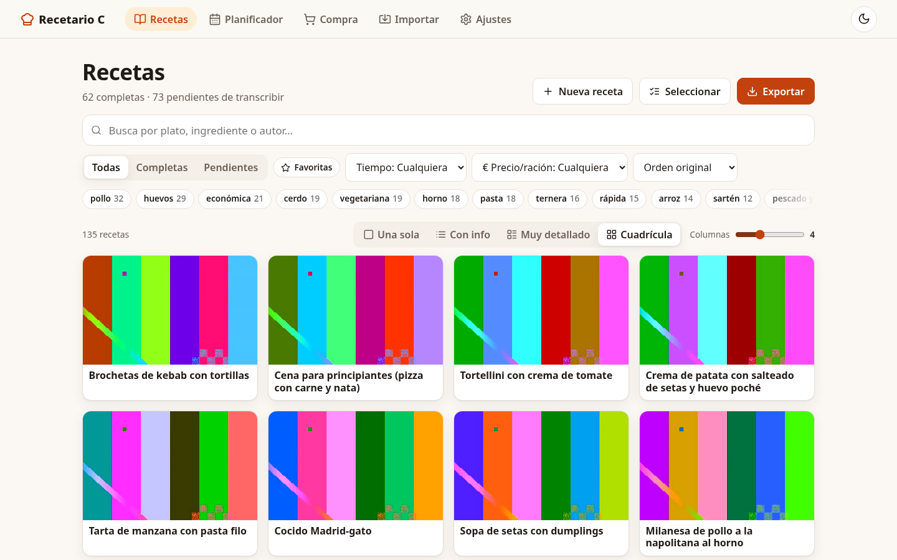
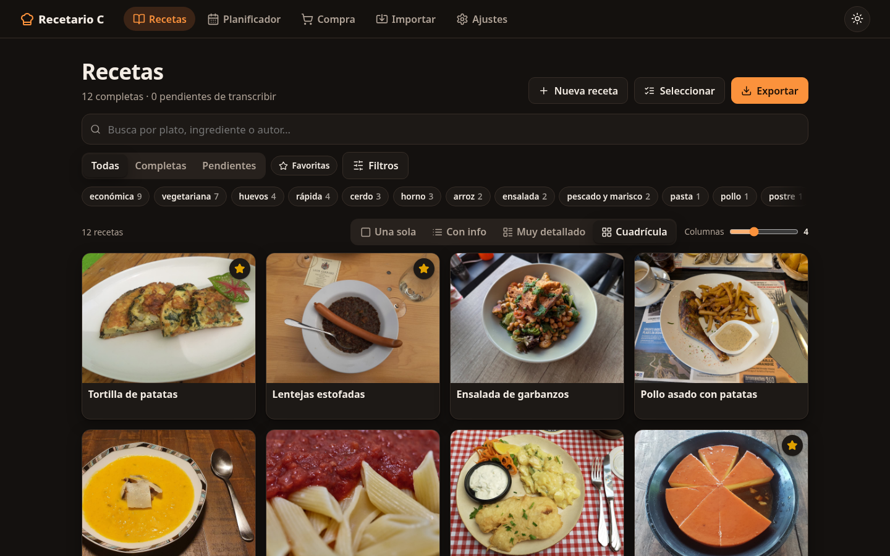
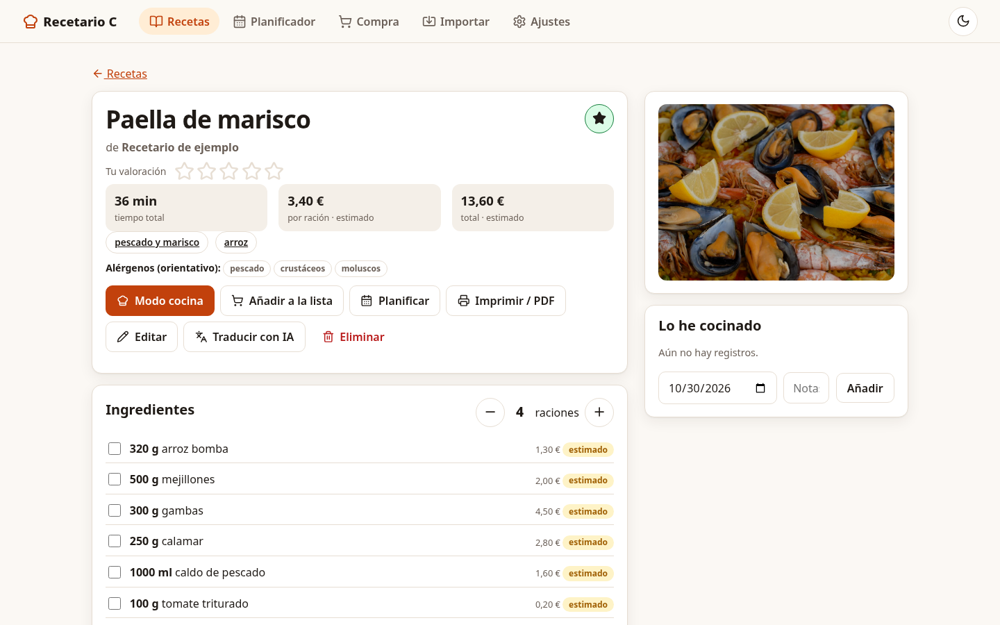
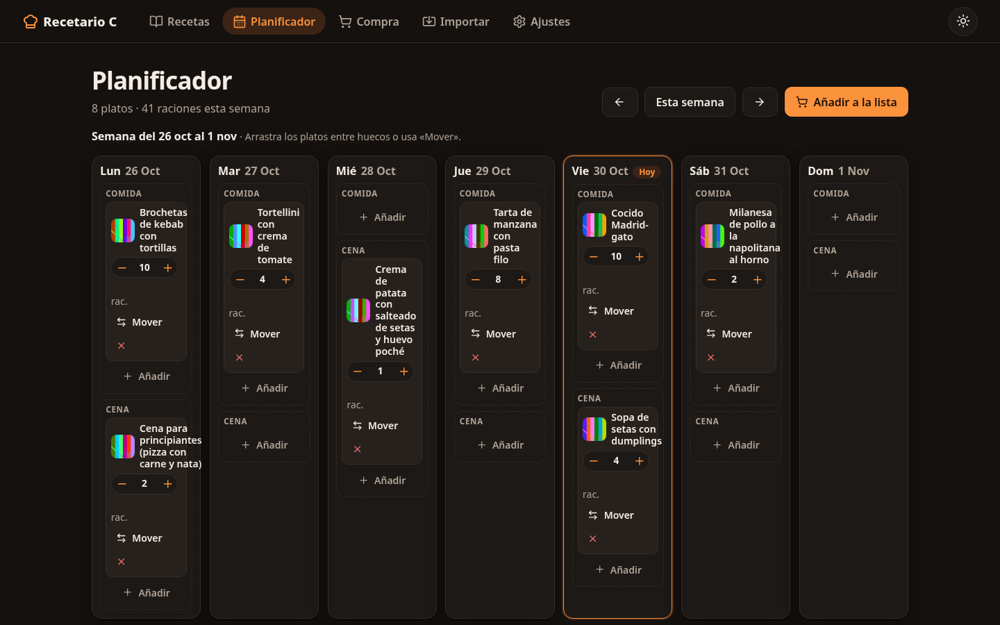
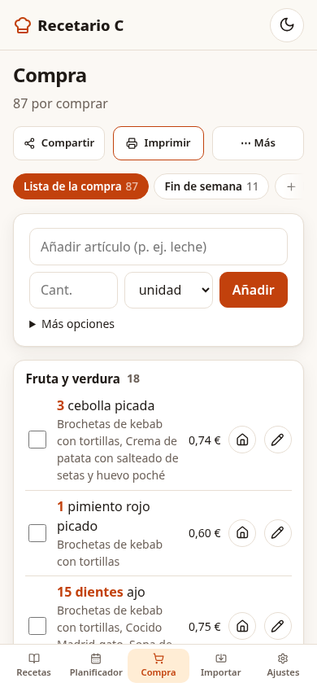
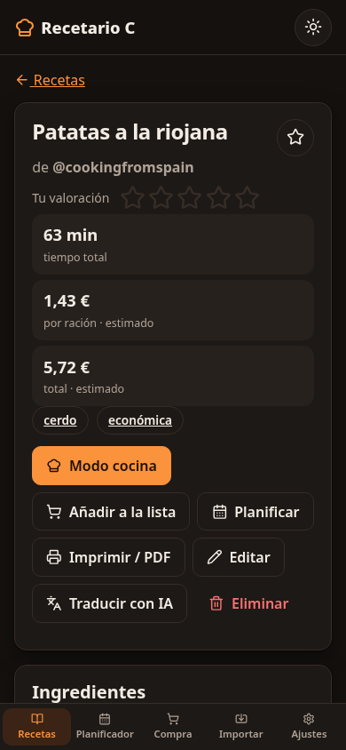
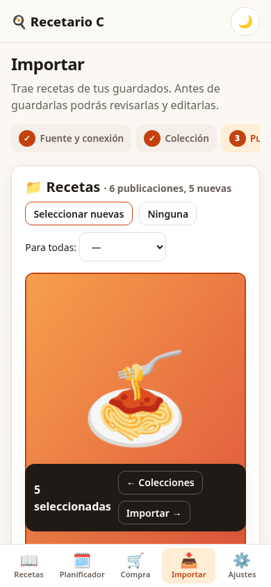
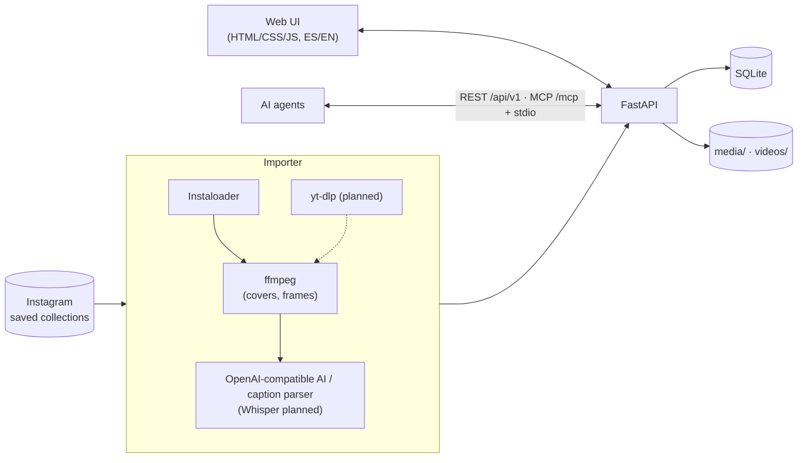

<p align="center"><a href="README.md">English</a> | <b>Español</b></p>

<p align="center"></p>
<h1 align="center">Recetario C</h1>
<p align="center"><b>Tus recetas guardadas de Instagram convertidas en un recetario autoalojado y local-first.</b></p>
<p align="center">
  
  
  
  
  
  
  
  
</p>
<p align="center"></p>

<p align="center">
  <picture>
    <source media="(prefers-color-scheme: dark)" srcset="docs/screenshots/lista-cuadricula-dark-desktop.png">
    
  </picture>
</p>

## ✨ Funciones

- 📥 **Importador de Instagram** – asistente de 5 pasos: colección guardada, publicaciones, revisión de borradores (sin duplicados).
- 🔎 **Recetas** – búsqueda tolerante a erratas, filtros, etiquetas/alérgenos, cinco vistas de lista con portada elegida.
- 🍳 **Modo cocina** – escalado de raciones, temporizadores por paso, pantalla completa con Wake Lock, imprimir/PDF.
- 🗓️ **Planificador** – semana por días y comidas, enviar a la compra en un clic.
- 🛒 **Compra y despensa** – varias listas, pasillos, conversión de unidades, recurrentes, precios *estimados*.
- 🤖 **Tu propia IA** – OpenAI, OpenRouter, Ollama, LM Studio…; clave cifrada.
- 🔌 **Acceso para agentes** – API REST con token y servidor MCP (HTTP + stdio).
- 📦 **Exportar** – JSON, HTML, Markdown, JSON compatible v1, ZIP con medios.
- 🌍 Interfaz ES/EN, tema claro y oscuro, adaptada a móvil.
- 🧭 *En la hoja de ruta:* pasos en paralelo, edición pública local-first, estadísticas de precios (ver abajo).

## 📸 Galería

<table>
<tr><td align="center"><br><sub>Cuadrícula (oscuro)</sub></td><td align="center"><br><sub>Detalle</sub></td><td align="center"><br><sub>Planificador (oscuro)</sub></td></tr>
<tr><td align="center"><br><sub>Lista de la compra</sub></td><td align="center"><br><sub>Detalle (móvil, oscuro)</sub></td><td align="center"><br><sub>Importar</sub></td></tr>
</table>

<sub>Solo datos de demostración con fotos CC0. Más en <a href="docs/screenshots/">docs/screenshots/</a>.</sub>

## 🏗️ Arquitectura



## 🚀 Arranque rápido

```bash
python -m venv .venv && . .venv/bin/activate   # Windows: .venv\Scripts\activate
pip install -r requirements.txt
python run.py                                  # http://localhost:8088 – el primer arranque crea el administrador
python run.py --mock-instagram                 # prueba el importador sin Instagram
```

Variables de entorno, primer administrador, agentes/MCP y seguridad: **[docs/CONFIG.md](docs/CONFIG.md)** · Despliegue en el mini PC con Windows: **[DEPLOY.md](DEPLOY.md)**.

## 🗺️ Hoja de ruta

- [x] v2.1.2 – portadas y cuadrícula
- [x] Landing bilingüe
- [ ] v2.2 – pasos en paralelo (DAG con `depends_on`)
- [ ] Fase 4 – versión pública local-first (SQLite WASM/OPFS, BYOK, exportar/importar, transferencia en LAN)
- [ ] Fase 3 – precios: «ahora más baratas», existencias de despensa, estadísticas
- [ ] Más fuentes (TikTok, YouTube, Pinterest, web), yt-dlp y transcripción con Whisper

Plan completo: [docs/ROADMAP.md](docs/ROADMAP.md) · Cambios: [CHANGELOG.md](CHANGELOG.md)

## 📄 Licencia

Pendiente: AGPL-3.0 o MIT. Hasta elegirla, todos los derechos reservados.

## 👤 Autor

[GitHub @B3RT1C](https://github.com/B3RT1C) · [LinkedIn](https://www.linkedin.com/in/albertopn)
