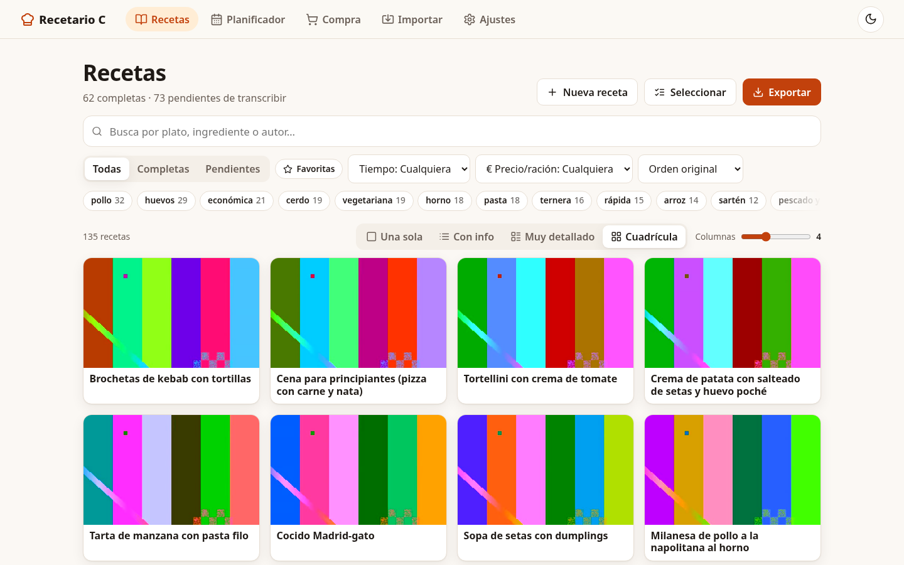
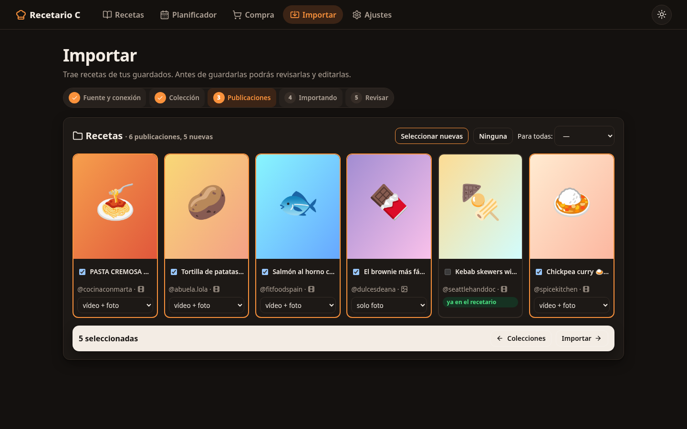
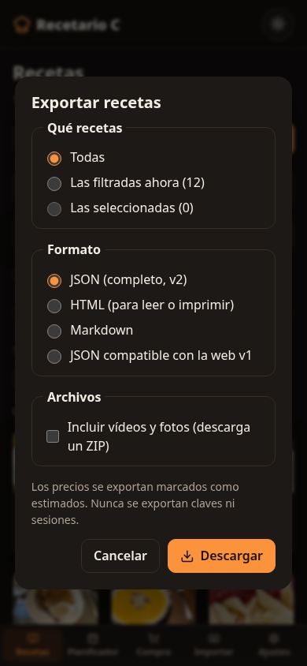

# Recetario C v2

Recetario personal: recetas guardadas de Instagram convertidas en recetas escalables, con precios **estimados**,
temporizadores, modo cocina, importador de Instagram, exportación, "Conecta tu IA" y acceso para agentes (REST + MCP).



| Detalle | Importar | Exportar (móvil, oscuro) |
|---|---|---|
|  |  |  |

Todas las capturas (claro/oscuro, 1440×900 y 390×844): `docs/screenshots/`.

## Arranque rápido

```bash
python -m venv .venv && . .venv/bin/activate        # Windows: .venv\Scripts\activate
pip install -r requirements.txt
python run.py                       # http://localhost:8088
python run.py --mock-instagram      # importador con datos de prueba, sin Instagram real
python run.py --videos-dir ../videos --port 8088 --host 0.0.0.0
```

Windows: `run.bat` (usa `.venv` si existe). Despliegue en el mini PC: ver [DEPLOY.md](DEPLOY.md).

### Variables de entorno

| Variable | Por defecto | Uso |
|---|---|---|
| `RECETAS_PORT` / `RECETAS_HOST` | `8088` / `0.0.0.0` | |
| `RECETAS_DATA_DIR` | `./data` | SQLite `recetas.db` |
| `RECETAS_MEDIA_DIR` | `./media` | fotos subidas/importadas |
| `RECETAS_VIDEOS_DIR` | `./videos` | vídeos `CODIGO.mp4` (compatible con la v1) |
| `RECETAS_SECRET_DIR` | `~/.recetas-web` | `secret.key` (Fernet) y sesión de Instagram |
| `RECETAS_IG_PROVIDER` | `instaloader` | `mock` para pruebas |
| `RECETAS_MAX_PHOTO_MB` / `RECETAS_MAX_VIDEO_MB` | `10` / `300` | límites de subida |

## Arquitectura

```
static/ (HTML + CSS + JS sin build, router por hash, i18n ES/EN)
   │ fetch /api/...            agentes ── /api/v1 (token) ── /mcp (token, streamable HTTP) ── stdio
FastAPI (app/main.py) ─ services/
   recipes (búsqueda difusa, filtros, etiquetas/alérgenos automáticos)   exporter (JSON/HTML/MD/ZIP)
   importer (jobs en segundo plano) ← sources (RecipeSource: instagram; tiktok/youtube/pinterest/web previstos)
   instagram (instaloader | mock)    caption_parser (español)    ai (OpenAI‑compatible | fake)
   prices (caché por ingrediente + PriceProvider + router con prioridad)   tokens (hash)   secrets (Fernet)
SQLite: recipes (documento JSON + columnas indexadas), drafts, jobs, tokens, settings, price_cache,
        shopping_lists / shopping_categories / shopping_items (modelo listo, UI pendiente)
```

- Cada receta es `completa` o `pendiente de transcribir` (las 73 "solo vídeo" de la v1).
- `legacy_document()` reconstruye exactamente el JSON v1 → exportar "JSON compatible v1" es sin pérdidas.
- Precios: cada ingrediente puede llevar `precio_fuente` / `precio_super` / `precio_fecha`; sin fuente = **estimado**.
  La UI muestra "real (fuente, fecha)" o "estimado".

## Funciones

- **Recetas**: búsqueda tolerante a erratas, Todas/Completas/Pendientes, favoritas, tiempo, precio/ración, orden,
  etiquetas; modo selección + exportar seleccionadas.
- **Detalle**: valoración, favorito, escalado de raciones (redondeo inteligente), temporizadores por paso, vídeo local o
  iframe de Instagram, registro "lo he cocinado", imprimir/PDF, **Modo cocina** (pantalla completa, Wake Lock), traducir con IA.
- **Añadir/editar**: ingredientes y pasos estructurados, pegar caption y parsear, subir foto/vídeo (validados por tipo y tamaño).
- **Importar** (asistente de 5 pasos, independiente de la fuente): conectar (usuario + contraseña con 2FA, o cookie
  `sessionid`) → colección → publicaciones con miniatura y vídeo/foto/ambos → progreso → revisar borradores.
  Deduplicado por shortcode. La contraseña **nunca** se guarda: solo el archivo de sesión.
- **Exportar**: todas / filtradas / seleccionadas · JSON, HTML, Markdown, JSON v1 · ZIP si incluye medios.
- **Ajustes**: tema, idioma, **Conectar tu IA** (presets OpenAI, OpenRouter, Ollama, LM Studio…; "Probar
  conexión"; clave cifrada, solo se muestran los 4 últimos caracteres), tokens de acceso, estado de Instagram, Acerca de.

## Acceso para agentes

Crea un token en **Ajustes → Acceso para agentes** (se muestra una vez; se guarda solo su hash). Ámbitos `read` / `write`.

REST (documentada en `/docs`):

```bash
curl -H "Authorization: Bearer rct_..." "http://localhost:8088/api/v1/recipes?q=pollo"
```

MCP (herramientas `search_recipes`, `get_recipe`, `list_collections`, `import_recipe`):

```jsonc
// Cliente con streamable HTTP
{ "mcpServers": { "recetas": { "url": "http://MINI-PC:8088/mcp", "headers": { "Authorization": "Bearer rct_..." } } } }
// Cliente que lanza un proceso (stdio), en la misma máquina
{ "mcpServers": { "recetas": { "command": "C:\\...\\recetas-web-v2\\.venv\\Scripts\\python.exe",
  "args": ["-m", "app.mcp_stdio"], "cwd": "C:\\...\\recetas-web-v2", "env": { "RECETAS_API_TOKEN": "rct_..." } } } }
```

## Demo estática

```bash
python scripts/build_static.py      # → dist/ (solo lectura, sin vídeos, miniaturas ni claves)
```

## Desarrollo

```bash
pip install -r requirements-dev.txt && python -m playwright install chromium
python -m pytest                                    # 44 tests (Instagram con proveedor mock)
python run.py --mock-instagram --port 8088 &
python scripts/screenshots.py --base http://127.0.0.1:8088
```

## Seguridad y limitaciones

- `secret.key` vive fuera de la carpeta de datos y está en `.gitignore`. **Haz copia**: sin ella hay que volver a
  introducir las claves de IA. Las claves nunca se envían al navegador, ni se registran ni se exportan.
- La UI web no tiene login: úsala solo en la LAN. `/api/v1` y `/mcp` sí exigen token.
- El login real de Instagram (instaloader) **no se ha probado en vivo**; Instagram puede pedir "challenge" o limitar.
  Importa en lotes pequeños (hay pausa entre publicaciones) y preferiblemente con la cookie `sessionid`.
- Planificador y Compra son marcadores de posición (modelo de datos de la lista de la compra ya creado).
