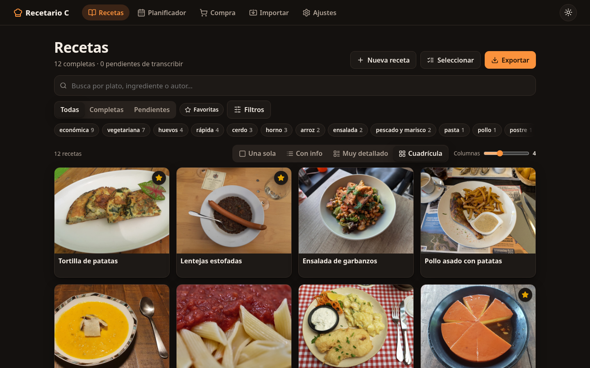
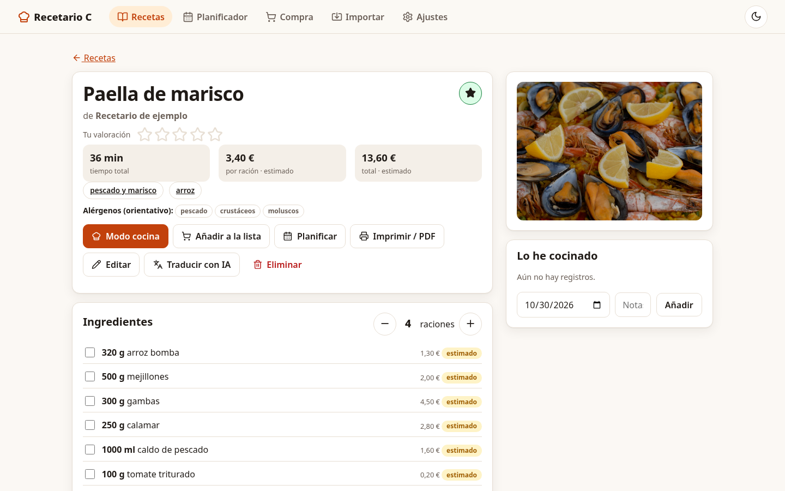
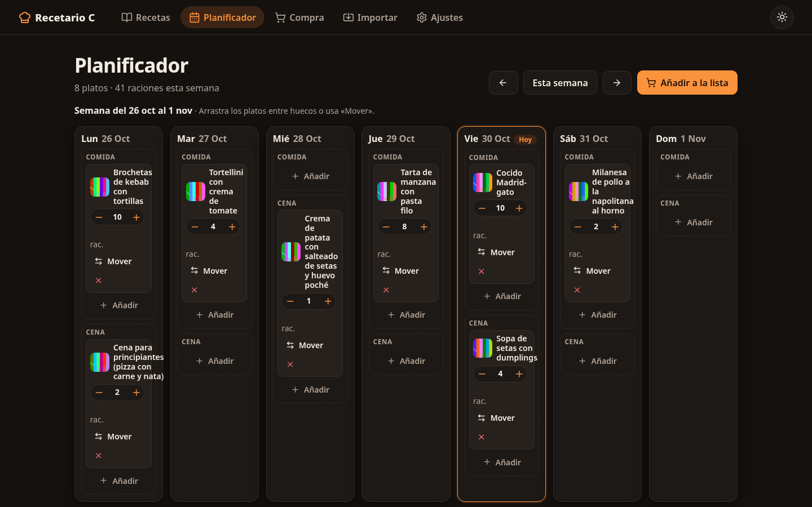
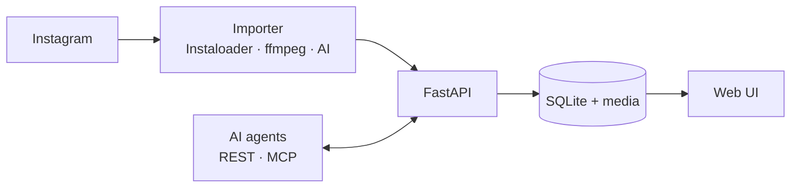

<p align="center"><b>English</b> | <a href="README.es.md">Español</a></p>

<p align="center"></p>
<h1 align="center">Recetario C</h1>
<p align="center"><b>Your saved Instagram recipes, turned into a self-hosted, local-first cookbook.</b></p>
<p align="center">
  
  
  
  
  
  
  
  
</p>
<p align="center"></p>

<p align="center">
  <picture>
    <source media="(prefers-color-scheme: dark)" srcset="docs/screenshots/lista-cuadricula-dark-desktop.png">
    
  </picture>
</p>

## ✨ Features

- 📥 **Instagram importer** – 5-step wizard: pick a saved collection, choose posts, review drafts (dedup by shortcode).
- 🔎 **Recipes** – typo-tolerant search, filters, tags/allergens, 4 views: single, compact list, list with thumbnail, grid.
- 🍳 **Cook mode** – serving scaling, per-step timers, full screen with Wake Lock, print/PDF.
- 🗓️ **Meal planner** – weekly plan by day and meal, one click to the shopping list.
- 🛒 **Shopping & pantry** – multiple lists, aisles, unit conversion, recurring items, *estimated* prices.
- 🤖 **Bring your own AI** – OpenAI, OpenRouter, Ollama, LM Studio…; key stored encrypted.
- 🔌 **Agent access** – token-scoped REST API and MCP server (HTTP + stdio).
- 📦 **Export** – JSON, HTML, Markdown, v1-compatible JSON, ZIP with media.
- 🌍 Spanish / English UI, light & dark theme, mobile friendly.
- 🧭 *Roadmap:* parallel steps, browser-only local-first edition, price stats – see below.

## 📸 Gallery

<table>
<tr><td align="center"></td><td align="center"></td><td align="center"></td></tr>
<tr><td align="center">Grid</td><td align="center">Detail</td><td align="center">Planner</td></tr>
<tr><td align="center"></td><td align="center"></td><td align="center"></td></tr>
<tr><td align="center">Shopping</td><td align="center">Detail</td><td align="center">Importer</td></tr>
</table>

<sub>Demo data with CC0 photos only. More in <a href="docs/screenshots/">docs/screenshots/</a>.</sub>

## 🏗️ Architecture



<sub>Detailed diagram: <a href="docs/CONFIG.md">docs/CONFIG.md</a></sub>

## 🚀 Quick start

```bash
python -m venv .venv && . .venv/bin/activate   # Windows: .venv\Scripts\activate
pip install -r requirements.txt
python run.py                                  # http://localhost:8088 – first run creates the admin
python run.py --mock-instagram                 # try the importer without Instagram
```

Environment variables, first admin, agents/MCP setup, security notes: **[docs/CONFIG.md](docs/CONFIG.md)** · Windows mini PC deployment: **[DEPLOY.md](DEPLOY.md)**.

## 🗺️ Roadmap

- [x] v2.1.2 – covers and grid view
- [x] v2.1.3 – view selector
- [x] v2.1.4 – roomier interface (8 px spacing, grouped header, density option)
- [x] v2.1.5 – hotfix: cache-busted assets, mobile planner layout
- [x] Bilingual landing page
- [ ] v2.2 – parallel recipe steps (`depends_on` DAG)
- [ ] Phase 4 – public local-first edition (SQLite WASM/OPFS, BYOK, export/import, LAN transfer)
- [ ] Phase 3 – prices: "cheaper now", pantry stock, statistics
- [ ] More sources (TikTok, YouTube, Pinterest, web), yt-dlp and Whisper transcription

Full plan: [docs/ROADMAP.md](docs/ROADMAP.md) · Changes: [CHANGELOG.md](CHANGELOG.md)

## 📄 License

Pending: AGPL-3.0 or MIT. Until a license is chosen, all rights reserved.

## 👤 Author

[GitHub @B3RT1C](https://github.com/B3RT1C) · [LinkedIn](https://www.linkedin.com/in/albertopn)
